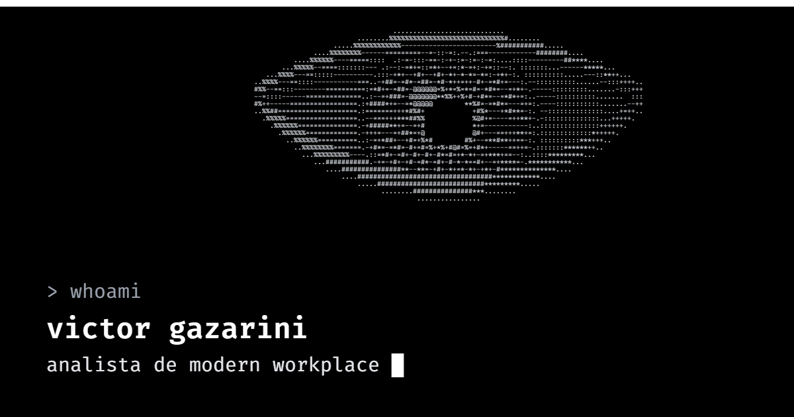

# portfolio

Meu portfólio pessoal.

https://victorgazarini.github.io/portfolio/

Feito com HTML, JavaScript e Tailwind CSS, publicado no GitHub Pages via GitHub Actions. Os projetos exibidos são carregados da API do GitHub.

Desenvolvido com auxílio do Claude Code.
